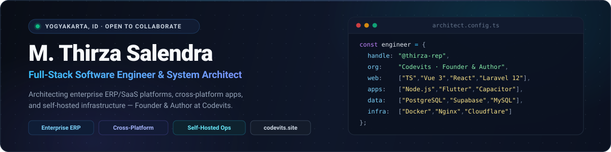

  

  
  
  
  

---

### About Me

I am **M. Thirza Salendra** (`@thirza-rep`), a **Full-Stack Software Engineer & System Architect** based in **Yogyakarta, Indonesia**, and the **Founder & Technical Author at [Codevits](https://www.codevits.site/)**.

I design and ship production-ready software end-to-end — from **ACID-compliant financial & ERP ledgers** and **multi-role SaaS backends** to **cross-platform web, mobile, and desktop apps**, backed by **self-hosted Docker infrastructure**.

<table>
  <tr>
    <td width="50%" valign="top">
      <strong>Enterprise Web &amp; SaaS Systems</strong> 
      Multi-tenant ERP, Point of Sale (POS), granular RBAC, Google OAuth 2.0, ACID ledger schemas, and RESTful API engineering with Laravel 12 &amp; Node.js/Express.
    </td>
    <td width="50%" valign="top">
      <strong>Cross-Platform Applications</strong> 
      Reactive web SPAs with TypeScript, Vue 3 (Pinia), React, and shadcn/ui; native &amp; hybrid builds across Android (Flutter, Capacitor) and Desktop (Electron).
    </td>
  </tr>
  <tr>
    <td width="50%" valign="top">
      <strong>Data, Search &amp; Geospatial</strong> 
      Relational modeling on PostgreSQL 16 (PL/pgSQL), Supabase, and MySQL 8; full-text search with Meilisearch; interactive WebGIS mapping via Leaflet.
    </td>
    <td width="50%" valign="top">
      <strong>Self-Hosted DevOps &amp; Automation</strong> 
      Containerized deployments with Docker &amp; Compose, Nginx reverse proxies, Linux home-server operations (CasaOS &amp; Cloudflare Tunnel), and WhatsApp OTP gateways.
    </td>
  </tr>
</table>

---

### Featured Projects

| Project | Overview & Capabilities | Core Stack | Access |
| :--- | :--- | :--- | :---: |
| **[CAKUE v2](https://github.com/thirza-rep/cakuev2)** | Enterprise SaaS ERP & Personal Finance platform featuring dual-ledger accounting, granular RBAC, Google OAuth 2.0, WhatsApp OTP gateway, and multi-platform Web/Android/Desktop builds. | `Vue 3` `Pinia` `Node.js` `Express` `PostgreSQL 16` `Docker` `Capacitor` `Electron` | [Live App](https://cakue.codevits.site) |
| **[ODOT ERP](https://github.com/thirza-rep/ODOT)** | Modern web ERP & Point of Sale (POS) with multi-role RBAC (Owner, Admin, Cashier), SKU inventory tracking, stock movements, and automated reporting. | `Laravel 12` `Tailwind CSS v4` `Alpine.js` `Docker` | [Live Demo](https://odot-inky.vercel.app/) |
| **[SIPAKTA](https://github.com/thirza-rep/sipakta)** | Digital Marriage Certificate Archival Information System built for KUA with full-text search, self-service applicant registration, document archiving, and periodic recaps. | `Laravel 12` `PHP 8.2+` `Full-Text Search` `Docker` | [Repository](https://github.com/thirza-rep/sipakta) |
| **[WebSampahku](https://github.com/thirza-rep/sampahku)** | Geospatial Waste Management WebGIS connecting Residents, Transporters, and Admins with live map markers, pickup workflows, and monthly billing verification. | `React` `Vite` `Leaflet.js` `Supabase` `PostgreSQL` | [Repository](https://github.com/thirza-rep/sampahku) |
| **[Semantik Repository](https://github.com/thirza-rep/semantik)** | Semantic Web Academic Thesis Repository featuring multi-role RBAC (Admin, Lecturer, Student), multi-criteria search, inline PDF preview, and real-time analytics. | `Laravel 11` `React 18` `Tailwind CSS` `PHP` | [Live Demo](https://semantik-5vov.vercel.app) |
| **[PT_MMS](https://github.com/thirza-rep/PT_MMS)** | Modern enterprise web system engineered with a type-safe React component architecture and PostgreSQL/PLpgSQL backend services. | `TypeScript` `React` `shadcn/ui` `Tailwind CSS` `Supabase` | [Repository](https://github.com/thirza-rep/PT_MMS) |
| **[Cakue Mobile](https://github.com/thirza-rep/Cakue)** | Offline-first personal finance mobile application supporting multi-user profiles, dynamic dark mode, and cloud synchronization with Google Drive & MySQL 8.0. | `Flutter` `Dart` `MySQL 8` `Docker` | [Repository](https://github.com/thirza-rep/Cakue) |

---

### Technical Ecosystem

<table>
  <tr>
    <td width="22%"><strong>Languages</strong></td>
    <td>
      
    </td>
  </tr>
  <tr>
    <td><strong>Frontend &amp; Apps</strong></td>
    <td>
      
    </td>
  </tr>
  <tr>
    <td><strong>Backend &amp; Data</strong></td>
    <td>
      
    </td>
  </tr>
  <tr>
    <td><strong>Infra &amp; Tooling</strong></td>
    <td>
      
    </td>
  </tr>
</table>

---

### Technical Writing & Community

> **[Codevits — Technology Journal & Engineering Portal](https://www.codevits.site/)**  
> Founded and authored independently to share structured guides on **Software Engineering**, **Database Architecture**, **Cloud & Self-Hosted Infrastructure**, **Zero-Trust Cybersecurity**, and **Applied AI** for engineers and students in Indonesia.

---

### GitHub Activity & Engineering Snapshot

  

  
  

---

  <strong>M. Thirza Salendra</strong> · Yogyakarta, Indonesia · <em>"Build systems that scale. Write code that lasts."</em>

